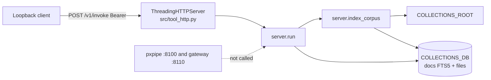
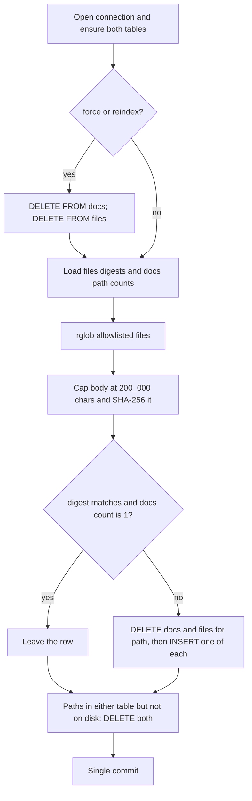
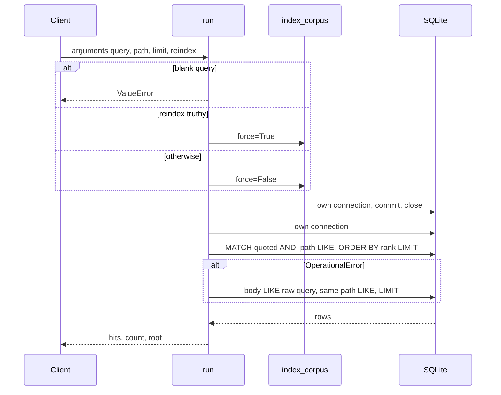

# Design: FTS5 digest freshness, quoted MATCH, and rank order

| Field | Value |
| --- | --- |
| Author | the maintainer of this repo |
| Date | 2026-10-16 |
| Status | Accepted |
| Scope | `tool-collections-search` only |
| Picked solution | Option A in `docs/research/brainstorm.md` |

CONSENSUS: yes

## Overview

`collections_search` is one loopback process: stdlib `ThreadingHTTPServer` (`src/tool_http.py`), a content-bearing SQLite FTS5 table, and no runtime dependencies. The HTTP contract is already the right shape. The index is not. `index_corpus` in `src/tool_collections_search/server.py` treats “path already in `docs`” as fresh, so an edit never lands unless `reindex` wipes the table, and a file removed from the corpus root stays searchable forever. `run` passes the raw query to `MATCH`, does not `ORDER BY rank`, and on `sqlite3.OperationalError` retries with `body LIKE` while dropping the caller’s `path` predicate.

This design keeps `docs` as `fts5(path, body, tokenize='unicode61')` and adds a normal side table `files(path, digest)` whose digest is the SHA-256 of the exact string stored in `docs`. The scan inserts, skips, replaces, or deletes from that pair. Search splits the query on whitespace, quotes each piece as an FTS string, joins with ` AND `, sorts by ascending `rank`, and applies the same `path LIKE` predicate on the MATCH query and on the LIKE fallback. pxpipe (`http://127.0.0.1:8100`) and the gateway (`http://127.0.0.1:8110`) stay host Agentix services. This process does not call them and does not grow a second HTTP stack.

## Background & Motivation

The tool is the client-side stand-in for `collections_search` / `file_search`. `README.md` binds the published port to loopback. `pyproject.toml` has `dependencies = []` and requires Python 3.11+. `Dockerfile` is `python:3.12-slim-bookworm`. Compose publishes `127.0.0.1:8092:8092` and sets `COLLECTIONS_ROOT=/app/corpus` and `COLLECTIONS_DB=/tmp/tool-data/collections.sqlite`. The only test, `tests/test_tool.py::test_search`, writes `note.md` containing `Agentic loop uses local tools and FTS5.`, force-indexes a temp database, and asserts that query `local tools` hits `note.md`.

The scan today:

```49:68:src/tool_collections_search/server.py
def index_corpus(force: bool = False) -> int:
    root = _root()
    root.mkdir(parents=True, exist_ok=True)
    con = _connect()
    if force:
        con.execute("DELETE FROM docs")
    count = 0
    existing = {row["path"] for row in con.execute("SELECT path FROM docs")}
    for p in root.rglob("*"):
        if not p.is_file() or p.suffix.lower() not in _TEXT_EXT:
            continue
        rel = str(p.relative_to(root))
        if rel in existing and not force:
            continue
        body = p.read_text(encoding="utf-8", errors="replace")[:200_000]
        con.execute("INSERT INTO docs(path, body) VALUES (?, ?)", (rel, body))
        count += 1
```

`_TEXT_EXT` is `.md`, `.txt`, `.rst`, `.json`, `.yml`, `.yaml`, `.csv`, `.py`, `.toml`. `force=True` deletes `docs` and then reads `existing`, which is empty, so a full rebuild does insert what is on disk. A normal invoke does not. `run` always calls `index_corpus(force=False)` unless `arguments["reindex"]` is truthy. There is no delete for paths that `rglob` no longer yields. FTS5 has no unique constraint on `path`, so a second `INSERT` for the same path would leave two rows; the set-membership skip is the only thing preventing that, and it also prevents updates.

The query today:

```83:97:src/tool_collections_search/server.py
    sql = "SELECT path, snippet(docs, 1, '[', ']', ' … ', 16) AS snip FROM docs WHERE docs MATCH ?"
    params: list[Any] = [query]
    if isinstance(path_filter, str) and path_filter:
        sql += " AND path LIKE ?"
        params.append(f"%{path_filter}%")
    sql += " LIMIT ?"
    params.append(limit)
    try:
        rows = list(con.execute(sql, params))
    except sqlite3.OperationalError:
        rows = list(con.execute(
            "SELECT path, substr(body,1,240) AS snip FROM docs WHERE body LIKE ? LIMIT ?",
            (f"%{query}%", limit),
        ))
```

`docs/research/top-solution-research.md` records the FTS5 facts these bugs run into. A content-bearing FTS5 table accepts ordinary `INSERT` / `DELETE`. A `MATCH` with no `ORDER BY` is an arbitrary order, so `LIMIT` can drop the better hit. `ORDER BY rank` is best-first because `rank` is `bm25()` with no extra arguments and that function is already multiplied by -1. A bareword is only non-ASCII codepoints, ASCII letters, digits, underscore, or codepoint 26; `AND` / `OR` / `NOT` are reserved and case sensitive; anything else must be a double-quoted FTS string with embedded quotes doubled. Whitespace between phrases is an implicit `AND`. `MATCH` on a bad string raises `sqlite3.OperationalError`. The project `.venv` reports SQLite 3.53.4 with `ENABLE_FTS5`. That probe did not measure the Debian image in `Dockerfile`; the image already runs this same `CREATE VIRTUAL TABLE`, so this design adds no new SQLite requirement.

`snippet(docs, 1, '[', ']', ' … ', 16)` reads FTS column 1 (`body`) and asks for 16 tokens, which is inside the documented 1..64 range. The ellipsis argument is the three-character string space, U+2026, space. Column index 1 is valid only while `docs` stays `(path, body)`.

Every `run` and every `index_corpus` opens its own `sqlite3` connection and closes it. `check_same_thread` stays at the default. `ThreadingHTTPServer` can overlap two requests on one file; the default lock wait is five seconds, then `OperationalError`. That is existing and is not this change.

## Goals & Non-Goals

### Goals

1. Keep `docs` as a content-bearing `fts5(path, body, tokenize='unicode61')` table.
2. Add `files(path TEXT PRIMARY KEY, digest TEXT NOT NULL)` and keep it aligned with `docs` on every scan, including databases that already have `docs` rows and no `files` row.
3. Refresh a path when the indexed text changes, delete a path when the file is gone, and wipe both tables on `force` / `reindex` before inserting what is on disk.
4. Make multi-word queries a quoted `AND` of each whitespace piece, not one phrase and not a raw FTS expression. `local tools` must still hit.
5. `ORDER BY rank` before `LIMIT`, ascending, no column weights.
6. Apply optional `path LIKE` on both the MATCH query and the LIKE fallback.
7. Leave the result object as `hits[{path, snippet}]`, `count`, `root`.
8. Cover the new behavior with temp-corpus, temp-db tests. No network, no pxpipe, no listening socket.
9. Ship with no new runtime dependency and no feature flag. Rollback is delete the sqlite file and restart.

### Non-Goals

- Porter, trigram, `tokenchars`, contentless FTS, external-content FTS, and `'delete-all'`. Porter is an English stemmer; this corpus includes `.py`, `.yml`, `.yaml`, `.json`, and `.toml`. Trigram is a different index. `tokenchars` would change what `C++` means and is not part of Option A.
- Any embedding model, `sqlite-vec`, Whoosh, Tantivy, or Meilisearch. No model card was opened in the research note, so this document names none.
- Calling pxpipe or the gateway, or replacing either with a hosted API.
- Replacing `ThreadingHTTPServer`. A new HTTP stack would be a second implementation and a runtime dependency. The research note does not say the stdlib server is wrong for a loopback tool with these routes.
- WAL, a busy-timeout retry loop, and a shared `sqlite3` connection across handler threads.
- Column weights (`bm25(docs, ...)` or `rank MATCH 'bm25(...)'`).
- Changing `SCHEMA` parameters (`query`, `path`, `limit`, `reindex`), the tool id `collections_search` in `server.py`, ports, `TOOL_TOKEN`, the extension allowlist, or the 200_000 character cap.
- Escaping `%` and `_` inside the path filter. The parameter is already a substring filter.
- A schema-version table or a hand-written migration script.
- The compose nit: `docker-compose.yml` mounts `collections_data:/tmp/tool-data` and has no top-level `volumes:` key. That file is not edited by this design.
- Renaming `server.TOOL` (`collections_search`) to the package name, and any README rewrite. The public function name stays.

## Proposed Design



One process. The corpus directory is the source of bytes. The sqlite file is a derived index, not a system of record. Host Agentix services are outside the diagram on purpose.

### Schema creation

`_connect()` already creates `docs` and returns a `sqlite3.Row` connection after `mkdir` of the parent of `COLLECTIONS_DB`. It also creates the side table. Both statements stay `IF NOT EXISTS`. No `ALTER` of `docs`. Snippet column 1 does not move.

```sql
CREATE VIRTUAL TABLE IF NOT EXISTS docs USING fts5(path, body, tokenize='unicode61');
CREATE TABLE IF NOT EXISTS files (
    path TEXT PRIMARY KEY,
    digest TEXT NOT NULL
);
```

`digest` is 64 lowercase hex characters. The primary key is the same relative path string `index_corpus` already stores: `str(p.relative_to(root))`, POSIX separators on this host, suffix lowercased only for the allowlist check.

`hashlib` from the stdlib is the hash. There is no new line in `pyproject.toml` `dependencies`.

```python
def _digest(body: str) -> str:
    return hashlib.sha256(body.encode("utf-8")).hexdigest()
```

The input is the exact `str` passed to `INSERT INTO docs`. Build it in one place so the hash cannot drift from the row:

```python
body = p.read_text(encoding="utf-8", errors="replace")[:200_000]
digest = _digest(body)
```

That is not a hash of the raw file bytes and not a hash of the text past the cap. Two files that differ only after character 200_000 have the same digest and the same indexed body; the scan skips. `errors="replace"` is unchanged, so undecodable bytes become U+FFFD inside the string that is both stored and hashed.

### Scan

`index_corpus(force: bool = False) -> int` still returns how many `docs` inserts it performed. Skips and deletions of vanished paths do not increment it. A second scan of an unchanged tree returns 0. `main()` may keep ignoring the return value.

`run` keeps its current branch: `reindex` truthy calls `index_corpus(force=True)`; otherwise `index_corpus(force=False)`. A blank query still raises `ValueError("query is required")` before either call, so an invoke cannot rebuild without a query. Startup still calls `index_corpus(force=False)` only.



Freshness predicate for a path that is on disk: `files.digest` equals the new digest and `docs` has exactly one row for that path. Anything else is rewritten. One rewrite path covers every non-skip case, so a legacy database does not need a manual migration.

| On disk | `files.digest` | `docs` rows for path | Action |
| --- | --- | --- | --- |
| yes | equal | exactly 1 | skip |
| yes | equal | 0 or more than 1 | delete both, insert one body and the same digest |
| yes | different or absent | any, including 0 | delete both, insert the new body and digest |
| no | present or absent | any | delete both |
| force, before the walk | any | any | delete every row in both tables, then every on-disk file is the “absent digest” row |

`DELETE FROM docs WHERE path = ?` removes every FTS row for that path, including duplicates left by an overlapping scan. The following `INSERT` leaves one. `files` cannot hold two rows because `path` is the primary key; delete-then-insert is still the write, not `REPLACE` into `docs` and not the external-content `'delete-all'` command.

Load counts once per scan, not once per file:

```python
known = {
    row["path"]: row["digest"]
    for row in con.execute("SELECT path, digest FROM files")
}
doc_counts: dict[str, int] = {}
for row in con.execute("SELECT path FROM docs"):
    doc_counts[row["path"]] = doc_counts.get(row["path"], 0) + 1
```

After the walk, vanished paths are `(set(known) | set(doc_counts)) - seen`. Under `force`, both maps are empty because the wipe happens first, in the same transaction, so the vanish pass is a no-op and the walk inserts the tree.

Commit once at the end. On exception, close without commit; the connection rolls the scan back, including a `force` wipe. `try` / `finally` closes the connection. The same close pattern applies to the search connection in `run`. That is leak hygiene on the handler thread, not a new transaction mode.

The digest does not avoid the directory walk or the `read_text`. Every invoke still walks the corpus, which is what the process already does. The digest only skips SQLite writes when the capped text is unchanged. Size and mtime are not consulted. A change past the cap is invisible on purpose.

`ThreadingHTTPServer` can run two scans at once. SQLite’s writer lock serializes the transactions. Each mutation is delete-then-insert inside the transaction, so the commit that lands last leaves one `docs` row for that path. Two overlapping first-time scans of the same unchanged file both skip or both rewrite to the same body; they must not leave two rows after both commit. The freshness predicate (count must be 1) collapses a duplicate on the next scan even if a crash or an old build left one.

### Search

Blank query handling stays the first lines of `run`:

```python
query = arguments.get("query")
if not isinstance(query, str) or not query.strip():
    raise ValueError("query is required")
```

`str.split()` with no arguments splits on whitespace and drops empty pieces. Quote each piece. Join with the uppercase operator ` AND `. Do not wrap the whole query in one pair of quotes.

```python
def _fts_query(query: str) -> str:
    pieces = query.split()
    if not pieces:
        raise ValueError("query is required")
    return " AND ".join('"' + piece.replace('"', '""') + '"' for piece in pieces)
```

| Caller `query` | Bound `MATCH` string |
| --- | --- |
| `local tools` | `"local" AND "tools"` |
| `local   tools` | `"local" AND "tools"` |
| `C++` | `"C++"` |
| `AND` | `"AND"` |
| `say "hello"` | `"say" AND """hello"""` |

`local tools` stays two terms. A document where those words are not adjacent still matches. The phrase `"local tools"` is not what this function produces. Quoting makes `C++` a legal FTS string instead of a syntax error, and makes the reserved words legal terms. The `unicode61` tokenizer still runs on the quoted text. This design does not add `tokenchars` and does not claim that `+` is retained as a token. The `C++` test below proves the query did not take the unfiltered LIKE path; it does not redefine the tokenizer.

`limit` stays `max(1, min(int(arguments.get("limit") or 8), 50))`. `path` is used only when it is a non-empty `str`, same as today.

MATCH statement, path clause optional, rank before limit:

```sql
SELECT path, snippet(docs, 1, '[', ']', ' … ', 16) AS snip
FROM docs
WHERE docs MATCH ?
  AND path LIKE ?          -- only when path is a non-empty str
ORDER BY rank
LIMIT ?
```

The first placeholder is the output of `_fts_query`, not the raw query. Ascending `rank` is best-first. Do not write `ORDER BY rank DESC`. Do not pass weights. Do not put `rank` in the JSON.

LIKE fallback, executed only inside `except sqlite3.OperationalError` around the MATCH `execute`. The fallback’s own `execute` is not inside that handler. The pattern is the raw query, not the quoted FTS string, because the fallback is a substring search. The path predicate is the same one the MATCH query used, including the same `%{path}%` parameter. No `ORDER BY` on this branch: it has no `rank`.

```sql
SELECT path, substr(body,1,240) AS snip
FROM docs
WHERE body LIKE ?
  AND path LIKE ?          -- same condition as MATCH, not a wider search
LIMIT ?
```

Result construction is unchanged:

```python
{
    "hits": [{"path": r["path"], "snippet": r["snip"]} for r in rows],
    "count": len(rows),
    "root": str(_root()),
}
```

A lock timeout is also `OperationalError`. Today’s handler would run the LIKE fallback for that too. This design keeps the broad catch, as specified, and does not sniff error strings. With one loopback client that is a low-severity aliasing, not a reason to add WAL or a retry loop.



### HTTP surface

`src/tool_http.py` is not modified.

- `GET /healthz` and `GET /health` return `{"status":"ok","tool": name, "mode":"local"}`.
- `GET /schema` returns `SCHEMA`.
- `POST /v1/invoke` and `POST /invoke` require `Authorization: Bearer <TOOL_TOKEN>` unless `TOOL_TOKEN` is empty. Default token is `local`.
- Body cap on the HTTP payload stays 2_000_000 bytes. `arguments` must be an object.
- `PermissionError` is 401. Any other exception is 400 with `trace` truncated to the last 1500 characters.
- `serve()` still uses `ThreadingHTTPServer`, `TOOL_HOST` default `127.0.0.1`, `TOOL_PORT` default `8090`. Compose and `README.md` set `8092`. Leave that split alone.
- `log_message` stays a no-op.

Each call still opens and closes its own sqlite connection. `index_corpus` closes its connection before `run` opens the search connection. They do not share a connection across handler threads.

### Tests

Extend `tests/test_tool.py`. Follow the existing test: `tmp_path` corpus, `monkeypatch.setenv` for `COLLECTIONS_ROOT` and `COLLECTIONS_DB`, call `index_corpus` / `run` in process. Do not bind a port, do not import `tool_http.serve`, do not open a socket, do not call `127.0.0.1:8100` or `:8110`.

PR1 queries that must hit through the still-unquoted MATCH path use barewords only: ASCII letters, digits, and underscore. A hyphen is not a bareword and would depend on PR2’s quoting or on the LIKE fallback.

| Test | Setup | Assertion |
| --- | --- | --- |
| `test_search` (existing) | `note.md` body `Agentic loop uses local tools and FTS5.` | `run({"query": "local tools"})` count ≥ 1 and `hits[0]["path"] == "note.md"` |
| Edited file, no `reindex` | Index `note.md` containing `alpha_token`. Rewrite the file to `beta_token` only. | `run({"query": "beta_token"})` with no `reindex` key hits the file. `run({"query": "alpha_token"})` has count 0. |
| Deleted file | Index `gone.md` containing `gone_token`, then unlink it, then `index_corpus(force=False)`. | `run({"query": "gone_token"})` count is 0. Direct SQL: no `docs` row and no `files` row for `gone.md`. |
| Unchanged file | `index_corpus` twice on one file. | Second call returns 0. `SELECT COUNT(*)` on `docs` and on `files` for that path are both 1. |
| Legacy rows | After a successful index, `DELETE FROM files` only, then change the body, then scan with `force=False`. | Search returns the new body. A `files` row exists again. Repeating the delete without changing the body still recreates `files` and leaves one `docs` row. |
| `force` | Insert an extra `docs` path that is not on disk, then `index_corpus(force=True)`. | That path is gone. Every allowlisted file on disk has one `docs` row and one `files` row. |

| Test | Setup | Assertion |
| --- | --- | --- |
| `local tools` still hits | Existing fixture. | Same assertion as `test_search`. |
| AND, not a phrase | Body `local index and tools` (the two words are not adjacent). | `run({"query": "local tools"})` hits that file. A single phrase query would miss it; this locks the join. |
| Punctuation does not take the unfiltered LIKE path | `keep/a.md` and `other/b.md` both contain the substring `C++`. Install the `_MatchConnection` helper below in count mode: SQL that contains `MATCH` increments a counter, then `super().execute` runs it. | `run({"query": "C++", "path": "keep"})` does not return `other/b.md`. The MATCH counter is ≥ 1 and a `body LIKE` statement was not executed. |
| Path filter on MATCH | `dir_a/a.md` and `dir_b/b.md` both contain `local`. | `run({"query": "local", "path": "dir_a"})` returns only paths containing `dir_a`. |
| Path filter on LIKE fallback | Same two files, body substring `purple_token`. Install `_MatchConnection` in raise mode: SQL that contains `MATCH` raises `sqlite3.OperationalError` and is not forwarded. Every other statement, including `CREATE` and the scan `run` performs first, is forwarded. | `run({"query": "purple_token", "path": "dir_a"})` returns the `dir_a` hit and not the `dir_b` hit. |
| Rank | `weak.md` is the word `alpha` once plus a long tail of other barewords. `strong.md` is the word `alpha` repeated 30 times and nothing else. Index weak first. | `run({"query": "alpha", "limit": 1})` has `hits[0]["path"] == "strong.md"`. Optional direct check on the same file: the `rank` of `strong.md` is less than the `rank` of `weak.md`. |

The rank fixture is the test’s responsibility because `run` does not return `rank`. One occurrence plus a long tail versus thirty occurrences and no tail is enough that default `bm25` will not tie; the test asserts order, not a numeric score. No column weights are added to make the fixture pass.

PR2’s two SQL-observing tests share one helper. They must not assign `sqlite3.Connection.execute`. On the project venv (Python 3.14.7, the interpreter behind `.venv/bin/pytest`) that assignment raises `TypeError: cannot set 'execute' attribute of immutable type 'sqlite3.Connection'`. Assigning `execute` on a connection instance raises `AttributeError` (`execute` is read-only). A plain `sqlite3.Connection` also has no `__dict__`, so the test cannot hang counters off the base instance. `set_trace_callback` is not a substitute: it can see SQL text, but a callback that raises does not stop `execute` and cannot force the MATCH `OperationalError` the fallback test needs.

`server.py` does `import sqlite3` and `_connect` calls `sqlite3.connect(str(_db()))` with no `factory`. Production code stays that way. The test patches `connect` on the module object `server.py` already imported. `srv` is `tool_collections_search.server`, the same alias `tests/test_tool.py` uses. The patch is `monkeypatch.setattr(srv.sqlite3, "connect", wrapper)`: save the original `connect` first, and pass `factory` to that original. Patching a different `sqlite3` binding would miss `_connect`.

```python
def install_match_connection(monkeypatch, *, raise_on_match: bool):
    seen: list[str] = []
    real_connect = srv.sqlite3.connect

    class _MatchConnection(sqlite3.Connection):
        def execute(self, sql, parameters=(), /):
            text = sql if isinstance(sql, str) else ""
            seen.append(text)
            if "MATCH" in text:
                if raise_on_match:
                    raise sqlite3.OperationalError("forced fallback")
            return super().execute(sql, parameters)

    def connect(database, *args, **kwargs):
        kwargs["factory"] = _MatchConnection
        return real_connect(database, *args, **kwargs)

    monkeypatch.setattr(srv.sqlite3, "connect", connect)
    return seen
```

`_MatchConnection.execute` records every statement, then either raises or forwards. Statements whose SQL does not contain `MATCH` — `CREATE`, the scan `run` performs before search, and the LIKE fallback — always go to `super().execute`. Only MATCH is special-cased. Count mode (`raise_on_match=False`) is the `C++` test: assert `sum("MATCH" in s for s in seen) >= 1` and `not any("body LIKE" in s for s in seen)`. Raise mode is the fallback test. The helper is installed before `run`, because `run` opens the scan connection and the search connection itself. Raising on every `execute`, or raising on `CREATE`, would break schema creation inside that same `run`. `server.py` does not call `executemany` or `executescript`; overriding `execute` is enough. Do not assign `sqlite3.Connection.execute`.

## API / Interface Changes

No HTTP or schema change. `GET /schema` still advertises:

- `query` (string, required)
- `path` (string, optional substring)
- `limit` (integer, default 8, clamped to 1..50 in `run`)
- `reindex` (boolean, default false)

`run`’s return value stays:

```python
{"hits": [{"path": str, "snippet": str}], "count": int, "root": str}
```

Internal additions, private to `server.py`:

- `_digest(body: str) -> str`
- `_fts_query(query: str) -> str`
- `files` ensured from `_connect()`
- `index_corpus` return value remains “inserts this call”, now meaning rewrite inserts, not “new paths only”

Callers of `index_corpus` today are `run` and `main`, plus `tests/test_tool.py`. No other module imports it.

## Data Model Changes

| Object | Change |
| --- | --- |
| `docs` | None. Virtual table `fts5(path, body, tokenize='unicode61')`. Content-bearing. Ordinary `DELETE` / `INSERT`. |
| `files` | New normal table. `path TEXT PRIMARY KEY`, `digest TEXT NOT NULL`. No body column. |
| Indexes | The primary key is the only new index. |
| Result JSON | None. |

`files` does not store a second copy of the body. `docs` already stores the capped text because it is content-bearing. That duplicate is accepted; it is why Option B lost (see Alternatives).

There is no migration script. The next `_connect` creates `files` if it is missing. The next `index_corpus` sees docs rows with no digest, treats them as stale, and rewrites them from disk. Historical duplicate `docs` rows for one path collapse on that rewrite. A change that lives only past the 200_000 character cap is not a change.

Storage per indexed file is the capped body inside the FTS table, FTS’s own index, and one `files` row of the relative path plus 64 hex bytes. The cap is 200_000 characters. The drop directory today is `corpus/README.md` (“Drop text files here for FTS indexing.”). This is a local index for one loopback client, not a sized multi-tenant store. No load test was run for this document; do not treat an invented latency number as a measurement. The structural cost that does change is: every invoke still reads every allowlisted file, and SQLite writes happen only for paths that fail the freshness predicate, plus deletions.

### Migration and rollback

The database file is `COLLECTIONS_DB`, default `/tmp/tool-data/collections.sqlite` (`server._db`). Compose sets the same path.

Forward migration is the `CREATE TABLE IF NOT EXISTS` plus the next scan. No operator step and no feature flag.

Rollback is: stop the process, delete that sqlite file, start the process again. Startup calls `index_corpus`, and `_connect` recreates `docs` and, on the new code, `files`. Deleting the file is the whole migration rollback. If the new code is reverted and the file is left in place, the old process ignores `files` and the old “path is present” skip returns; delete the file in that case too so the rebuilt `docs` table matches the corpus. Prefer delete-and-restart over trying to salvage rows.

## Alternatives Considered

### Option B — external-content FTS5 plus triggers

Put path, digest, and body in a normal table. Point FTS5 at it with `content=` and `content_rowid=`, and install the insert, delete, and update triggers from the FTS5 documentation. Search would still be a quoted `MATCH` and `ORDER BY rank`.

The body would be stored once. Snippets work only while the index matches the content table. Deletes must pass the old column values; if they differ, later queries are unreliable. External-content tables do not honor `REPLACE`. `'delete-all'` would replace the current `DELETE FROM docs`, and that command is only for external-content and contentless tables. The directory walker would remain, because files are not rows until Python writes them. Triggers do not watch the filesystem.

Rejected for this tree. The corpus drop directory is a README plus whatever the operator adds, each body is capped at 200_000 characters, and the database is a local index, not a system of record. One extra copy of the body does not justify the external-content pitfalls. A side table of digests does not change the FTS column list, so existing `docs` databases and `snippet(..., 1, ...)` stay valid. Option A is the same search behavior with less schema.

### Option C — another engine, or a vector extension plus an embedding model

Whoosh and whoosh3 are a pure-Python index and a runtime package. The research note records that the original Whoosh project went dormant and that whoosh3 3.54.0 is a later fork. The current tests and the `docs` schema would not carry over.

Tantivy’s Python bindings are a native dependency (`tantivy` on PyPI). If no wheel exists, the build needs a Rust toolchain. That is a separate index format and it breaks the empty `dependencies` list.

Meilisearch is a second binary. Its docs call the hosted cloud the recommended way to run it and describe self-hosting as another process. This repo’s rule is no third-party search service.

`sqlite-vec` is a loadable C extension, pre-v1, installed with pip, not part of the SQLite amalgamation. Python’s `sqlite3` documentation says loadable extensions are off by default. The research probe’s `enable_load_extension(True)` did not raise and did not load a library; that is not evidence the extension is available. No embedding model was selected and no model card was opened. Keyword rank for this tool is FTS5 `rank` / `bm25`, which is already in SQLite. pxpipe is not an embedder for this tool and is not called from the search path.

Rejected. Each of these adds a package, a native build, a second process, or a pre-v1 extension. FTS5 is already the keyword contract `collections_search` implements. The checked-out `.venv` has SQLite 3.53.4 with `ENABLE_FTS5`.

### Freshness signals that are not the digest

The research note says a content-bearing table plus an application check of size, mtime, or a hash stays inside FTS5. Option A already picked the hash. Size and mtime are not used. Size does not see an edit that preserves length. Mtime does not see a change past the 200_000 character cap any more honestly than the digest, and it does change when the indexed bytes did not. The digest is defined as the SHA-256 of the string that was inserted, so the skip decision and the stored body are the same value.

## Security & Privacy Considerations

Assets: the corpus files, the sqlite index, and `TOOL_TOKEN`.

| Threat | Severity | What this design does |
| --- | --- | --- |
| Remote use of the search API | High if the port is published beyond loopback | Unchanged. Default `TOOL_HOST` is `127.0.0.1`. Compose publishes `127.0.0.1:8092:8092` and sets `TOOL_HOST=0.0.0.0` only inside that network namespace. Bearer token stays. Default `local` is already documented as unsafe off loopback. |
| FTS expression injection (`AND` / `OR` / `NOT`, punctuation, a `"` that closes a string) | Medium today, because the raw query is the MATCH expression | Each whitespace piece is a quoted FTS string and embedded `"` is doubled. The bound value is still a `?` parameter. Quoting is the documented stable shape for user text. |
| SQL injection | Low, already parameterized | `MATCH`, `LIKE`, `path`, and the digest writes stay on `?` placeholders. The path value is not concatenated into SQL. |
| Path filter widened by `%` or `_` | Low | Accepted. `path` is a substring filter. It is not a new behavior and it is not SQL injection. This design does not escape LIKE metacharacters. |
| Corpus path escape | Low | Indexed paths come from `relative_to(root)` on `rglob` of `COLLECTIONS_ROOT`. The query string is not a filesystem path. |
| Snippets and traces leaving the host | Low on loopback | Result snippets are the point of the API. `log_message` stays silenced. The 400 body still includes a truncated traceback, as today. Do not add logs of bodies or digests. |
| Hash disclosure | Low | The digest is not in `SCHEMA` and not in the result. It is an integrity key for the local file, not a secret. |
| pxpipe or gateway as a search dependency | High if introduced | Not called. A failure of `:8100` or `:8110` does not affect this process. |

`http.server` is not a production server. The research note says so, and says `send_header` does not reject CRLF. This tool does not put request data into response headers. Binding to loopback plus the bearer check are the application controls. They stay.

The digest is SHA-256 of capped UTF-8 text via `hashlib`. No keyed hash and no new cryptographic dependency.

## Observability

No new endpoint, log line, metric, or dependency.

- Liveness stays `GET /healthz`. Compose already probes `http://127.0.0.1:8092/healthz` from inside the container with the Python stdlib. `Dockerfile` has the same check.
- Index and query failures stay HTTP 400 `{"ok": false, "error", "trace"}`. Auth failures stay 401.
- `index_corpus`’s integer return is the write counter tests can assert. It is not added to the invoke result. Putting it there would change the result shape.
- Access logs stay suppressed. Do not log corpus text, queries, or digests. The caller already receives snippets.
- There is no alerting channel beyond the compose healthcheck. A metrics library would violate the empty dependency list. Two overlapping requests can still spend the default five-second sqlite lock wait; that shows up as the existing 400 if it surfaces as `OperationalError` outside the MATCH catch, or as a LIKE fallback if it surfaces on the MATCH statement. No new alarm is added for it.

## Rollout Plan

No feature flag. Merging PR1 changes scan behavior for every invoke. Merging PR2 changes query text and ordering for every invoke. Both are safe on an existing database file:

1. Deploy the process (image or `python -m tool_collections_search.server`).
2. The first `_connect` creates `files` beside the existing `docs` table.
3. The first scan rewrites every path once, because no digest exists, then skips unchanged files.
4. Search starts using quoted `AND` and `ORDER BY rank` only after PR2 is in the same process.

Order is PR1 then PR2 so the `server.py` diff stays reviewable. PR2 does not need the side table to be correct; a fresh database still indexes under the old scanner. Do not ship a configuration switch to turn either behavior off.

Rollback of either PR: revert the commit, delete `COLLECTIONS_DB`, restart. See Migration and rollback. There is no flag to flip and no online rebuild command beyond the existing `reindex` argument, which still means “wipe both tables and insert what is on disk” after PR1.

Compose is unchanged. The missing top-level `volumes:` key is not fixed here. Do not couple that deploy nit to the index change.

Staged rollout is “the one local process”. There is no second region and no canary population.

## Risks

| Risk | Severity | Mitigation |
| --- | --- | --- |
| First scan after upgrade rewrites every indexed file once | Low | The table is a local cache. The current drop directory is one short README. The rewrite is the migration. It is one transaction. |
| Change past character 200_000 is invisible | Low | Same cap as today. The digest is defined on the stored string so the skip cannot disagree with `docs`. |
| `"C++"` is legal MATCH text and still tokenized by `unicode61` without `tokenchars` | Medium if a caller expected symbol-accurate search | Do not “fix” that in this slice with trigram or `tokenchars`. The punctuation test asserts fallback behavior and the path predicate, not `+` as a token. |
| LIKE fallback has no rank and uses a raw substring | Low | It runs only when MATCH raises. Quoting removes the usual reason. The path predicate still applies. Snippet on that branch stays `substr(body,1,240)`. |
| MATCH `OperationalError` from a lock is treated as a syntax failure | Low | Pre-existing broad catch. Left in place. No WAL and no retry in this design. |
| Concurrent scans | Low | One commit per scan. Delete-then-insert plus “exactly one docs row” on the next scan. No shared connection. |
| Rank test depends on bm25 term frequency | Low | Fixture is one hit plus a long tail versus 30 hits and no tail, `limit` 1, weak file inserted first. Assert the path, not a score constant. |
| Undefined compose volume `collections_data` | Low for this slice, real for deploy | Non-goal. Not changed. Not used as a reason to pick a different engine. |

## Open Questions

None. The engine is Option A. The tokenizer stays `unicode61`. The digest is SHA-256 hex of the capped `errors="replace"` string. The query is a quoted `AND`, not a phrase. Rank is ascending and unweighted. The LIKE fallback keeps `path`. HTTP, auth, ports, and the result shape stay. Rollback is delete the sqlite file. The compose volume key is out of scope. An implementer does not choose among those again.

## Key Decisions

1. **Stay on content-bearing FTS5.** `docs(path, body, tokenize='unicode61')` already matches `snippet` column 1 and the only test. Option B adds triggers and external-content pitfalls for a walker that still lives in Python. Option C adds a package or a second process. pxpipe is not part of the tool.
2. **Freshness is a side-table digest, not “path exists”.** The skip in `index_corpus` is the staleness bug. SHA-256 of the inserted string makes the skip honest. `hashlib` is stdlib. Size and mtime are the wrong predicate for a capped string.
3. **One rewrite path.** If the digest mismatches, the `files` row is missing, or `docs` does not have exactly one row, delete that path from both tables and insert once. Legacy databases backfill on the next scan without a migration script. `force` / `reindex` wipes both tables first.
4. **Quote each whitespace piece and join with ` AND `.** That keeps `local tools` as two terms, which is what the existing test searches, and it makes punctuation and reserved words legal. One phrase around the whole query is the wrong shape.
5. **`ORDER BY rank` ascending, no weights.** The research note: without `ORDER BY`, `LIMIT` can drop the better hit; `rank` is the fast name for unweighted `bm25`, and smaller is better. Weights would change scores with no requirement.
6. **The path predicate is part of both queries.** A MATCH failure must not widen the search to the whole corpus. The LIKE pattern stays the raw query string.
7. **No new runtime machinery.** No WAL, no Porter, no new HTTP stack, no feature flag, no metrics endpoint. The concrete bugs are in `server.py` and are fixed there. `src/tool_http.py`, `SCHEMA`, and `docker-compose.yml` stay.
8. **Rollback is delete `COLLECTIONS_DB` and restart.** The file is an index. The next process recreates the tables it knows how to create.

## References

- `src/tool_collections_search/server.py` — `SCHEMA`, `_connect`, `index_corpus`, `run`, `main`
- `src/tool_http.py` — `check_auth`, `make_handler`, `serve`, `ThreadingHTTPServer`
- `src/tool_collections_search/__init__.py` — package version `1.0.0` (not the HTTP tool id)
- `tests/test_tool.py` — `test_search`
- `pyproject.toml` — `dependencies = []`, Python `>=3.11`, dev extra `pytest`
- `Dockerfile` — `python:3.12-slim-bookworm`, `EXPOSE 8092`, in-container `/healthz`
- `docker-compose.yml` — loopback publish, `COLLECTIONS_DB`, volume name `collections_data` with no top-level `volumes:` key
- `docs/research/brainstorm.md` — Option A picked; B and C rejected (2026-10-16)
- `docs/research/top-solution-research.md` — FTS5, stdlib HTTP, and the rejected engines (2026-10-16)
- `README.md` — loopback run instructions and the bearer token
- `corpus/README.md` — the only file in the drop directory today
- SQLite FTS5: https://www.sqlite.org/fts5.html (page timestamp recorded in the research note: 2026-10-09)
- Python `http.server` and `sqlite3`: cited from the research note’s stdlib section

## PR Plan

### PR 1 — `fix: refresh FTS rows from a digest side table`

- **Files / components:** `src/tool_collections_search/server.py`, `tests/test_tool.py`
- **Depends on:** none
- **Description:** Add `files` in `_connect`. Hash the capped body with `hashlib.sha256` and implement the scan table above: skip when the digest matches and exactly one `docs` row exists, otherwise delete that path and insert, delete paths missing from disk, and wipe both tables on `force`. Tests in this PR: edited file is visible without `reindex`, deleted file disappears from `docs` and `files`, an unchanged file stays one row and the second scan returns 0, a `docs` row with no `files` row is rehashed, `force` drops a path that is not on disk. Keep `test_search` green. Do not change MATCH, rank, or the LIKE fallback in this PR. Queries in the new tests are barewords so they pass before quoting exists.

### PR 2 — `fix: quote MATCH terms, order by rank, and keep the path filter`

- **Files / components:** `src/tool_collections_search/server.py` (`_fts_query` and `run` only), `tests/test_tool.py`
- **Depends on:** PR 1, for a clean diff on `server.py` and `tests/test_tool.py`. No functional dependency on `files`. Rebase onto PR1; do not reimplement the scanner.
- **Description:** Add `_fts_query`. Bind that string to `MATCH`. Append `ORDER BY rank` before `LIMIT`. Build the LIKE fallback with the same optional `path LIKE` and the raw query pattern. Leave `snippet(docs, 1, '[', ']', ' … ', 16)`, the result keys, and `src/tool_http.py` alone. Production `_connect` stays `sqlite3.connect(str(_db()))` with no `factory`. Tests in this PR: existing `local tools` hit, a non-adjacent `local` / `tools` body that a single phrase would miss, `C++` does not execute unfiltered `body LIKE` and does not return the decoy outside `path`, path filter on a normal MATCH, path filter when MATCH is forced to raise `OperationalError`, and `limit: 1` returns the stronger `alpha` document first. The two MATCH observations use `_MatchConnection`, a `sqlite3.Connection` subclass passed as `factory` through a patch of `server.sqlite3.connect`. They do not assign `sqlite3.Connection.execute`, and they do not use `set_trace_callback` to force the fallback.
